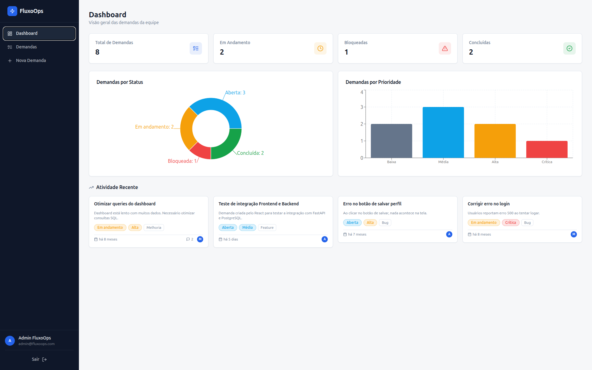
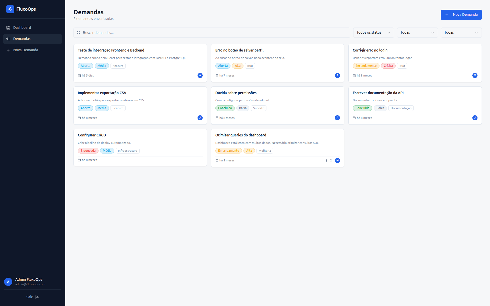
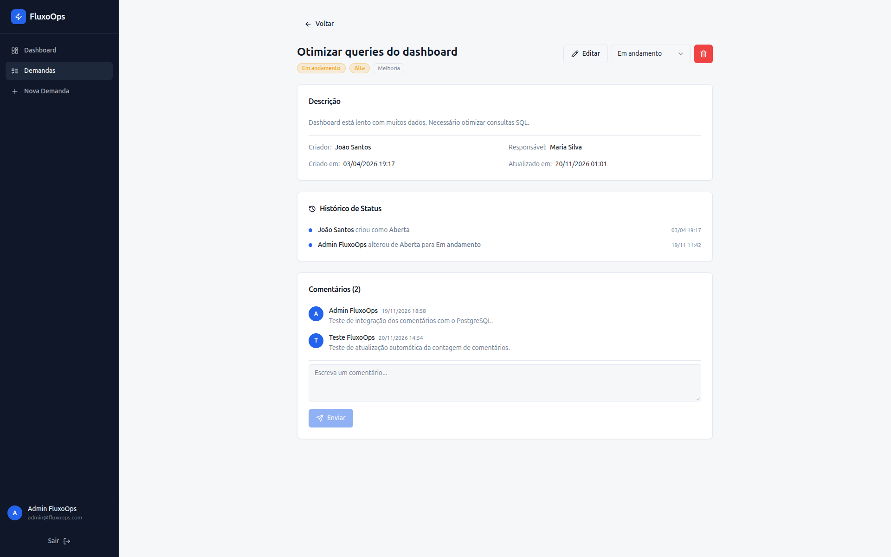

# FluxoOps — Frontend

Interface web do **FluxoOps**, uma aplicação Full Stack para gestão colaborativa de demandas e solicitações internas.

O sistema permite que equipes organizem solicitações, acompanhem o andamento das atividades, atribuam responsáveis, registrem comentários e visualizem indicadores operacionais em um dashboard.

Este repositório contém o **frontend**, desenvolvido com React, TypeScript e Vite, integrado a uma API REST construída com Python, FastAPI e PostgreSQL.

**Backend:** [FluxoOps API](https://github.com/Lucas-PadovanCintra/fluxoops-api)

> Projeto de portfólio voltado à demonstração de habilidades em desenvolvimento Full Stack, integração com APIs REST, autenticação, gerenciamento de estado e construção de interfaces web.

## Tecnologias

| Tecnologia | Utilização |
|---|---|
| React | Construção da interface |
| TypeScript | Tipagem e organização do código |
| Vite | Ambiente de desenvolvimento e build |
| Tailwind CSS | Estilização |
| shadcn/ui | Componentes de interface |
| React Router | Navegação entre páginas |
| API REST | Comunicação com o backend FastAPI |

## Funcionalidades

- Cadastro e autenticação de usuários.
- Login e logout com autenticação JWT.
- Proteção de páginas que exigem autenticação.
- Dashboard com indicadores de demandas.
- Listagem e visualização detalhada de demandas.
- Criação e edição de demandas.
- Classificação por categoria, prioridade e status.
- Atribuição de responsáveis.
- Busca e filtros para organização das demandas.
- Visualização e registro de comentários.
- Consulta do histórico de alterações de status.
- Sugestão de categoria e prioridade para novas demandas.
- Interface responsiva com componentes reutilizáveis.

As informações são obtidas por meio da API FastAPI. O frontend não depende de dados fictícios locais para executar as funcionalidades principais.

## Capturas de tela

### Dashboard

Indicadores operacionais, distribuição de demandas por status e prioridade e atividades recentes.



### Gerenciamento de demandas

Listagem de demandas com busca, filtros e informações de classificação e responsáveis.



### Detalhes da demanda

Visualização de informações, histórico de alterações de status e comentários dos usuários.



## Arquitetura

O frontend organiza suas responsabilidades em páginas, componentes, contextos, serviços e tipos TypeScript.

```text
src/
├── components/       # Componentes reutilizáveis
│   └── auth/         # Componentes de autenticação
├── contexts/         # Estado e contextos React
├── pages/            # Páginas da aplicação
├── services/         # Comunicação com a API
├── types/            # Tipos TypeScript
└── App.tsx           # Configuração principal da aplicação
```

A comunicação com o backend é realizada por serviços responsáveis pelas requisições HTTP.

Os contextos React gerenciam informações compartilhadas, como autenticação e demandas.

## Executando localmente

### Pré-requisitos

- Node.js 20.19+ ou 22.12+ (ou versões posteriores compatíveis) e npm.
- Backend FluxoOps configurado e em execução.
- PostgreSQL configurado para o backend.

### 1. Clonar o repositório

```bash
git clone https://github.com/Lucas-PadovanCintra/fluxoops-frontend.git
cd fluxoops-frontend
```

### 2. Instalar as dependências

```bash
npm install
```

### 3. Configurar a conexão com a API

Crie um arquivo `.env.local` a partir do exemplo:

```bash
cp .env.example .env.local
```

O arquivo deve conter:

```dotenv
VITE_API_URL=http://localhost:8000
```

Essa variável define o endereço do backend FastAPI utilizado pelo frontend.

Caso o backend esteja sendo executado em outro endereço, ajuste o valor de `VITE_API_URL`.

O arquivo `.env.local` contém configurações específicas do ambiente e não deve ser enviado ao GitHub.

### 4. Iniciar o backend

O frontend depende da API FluxoOps.

Siga as instruções de instalação do repositório [fluxoops-api](https://github.com/Lucas-PadovanCintra/fluxoops-api).

Por padrão, a API deve estar disponível em:

`http://localhost:8000`

A documentação interativa pode ser acessada em:

`http://localhost:8000/docs`

### 5. Iniciar o frontend

```bash
npm run dev
```

O Vite exibirá no terminal o endereço local da aplicação, normalmente:

`http://localhost:8080`

Acesse esse endereço no navegador.

## Autenticação e dados demonstrativos

O backend disponibiliza usuários demonstrativos para utilização em ambiente local.

| E-mail | Senha | Perfil |
|---|---|---|
| admin@fluxoops.com | admin123 | Administrador |
| maria@fluxoops.com | senha123 | Usuário |
| joao@fluxoops.com | senha123 | Usuário |

Para disponibilizar esses usuários, execute o script de inicialização de dados do backend:

```bash
python seed.py
```

As credenciais acima destinam-se exclusivamente ao ambiente local de demonstração e não devem ser utilizadas em produção.

## Integração com o backend

O frontend consome os endpoints REST do FluxoOps para:

- Autenticação e identificação do usuário.
- Consulta e gerenciamento de demandas.
- Listagem de usuários e responsáveis.
- Registro e consulta de comentários.
- Consulta do histórico das demandas.
- Indicadores do dashboard.
- Sugestão de classificação.

A autenticação utiliza tokens JWT fornecidos pelo backend.

## Validação e build

O frontend utiliza ESLint para análise estática, TypeScript para verificação de tipos e Vitest para testes automatizados.

Comandos disponíveis:

- `npm run lint` — verifica o código com ESLint.
- `npx tsc --noEmit` — verifica os tipos TypeScript.
- `npm test` — executa os testes automatizados.
- `npm run build` — gera a versão de produção no diretório `dist/`.

Atualmente, existem quatro testes automatizados de autenticação e proteção de rotas. Eles verificam redirecionamento, acesso autenticado, carregamento e tratamento de erros.

Na última validação local, ESLint, TypeScript, os quatro testes e o build de produção foram concluídos com sucesso.

## Backend e testes

Os testes automatizados da API estão disponíveis no repositório [fluxoops-api](https://github.com/Lucas-PadovanCintra/fluxoops-api).

O backend utiliza Pytest e um banco PostgreSQL separado para executar seus testes sem modificar os dados da aplicação principal.

## Desenvolvimento do projeto

A interface inicial foi criada com auxílio da plataforma Lovable e posteriormente adaptada para integração com o backend FastAPI.

O desenvolvimento incluiu a substituição dos dados fictícios por requisições reais à API, implementação do fluxo de autenticação, integração das funcionalidades e ajustes na organização do código.

## Possíveis melhorias futuras

- Ampliação da cobertura de testes automatizados para demandas, formulários e integração com a API.
- Melhorias de acessibilidade.
- Otimização do tamanho dos arquivos de produção.
- Recuperação de senha.
- Notificações em tempo real.
- Deploy público da aplicação.
- Pipeline de integração contínua.

---

**FluxoOps** — Projeto de portfólio Full Stack com React, TypeScript, FastAPI e PostgreSQL.
